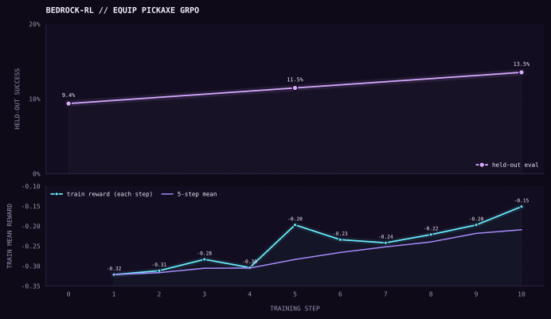

# Equip the iron pickaxe with GRPO

The hotbar contains nine randomized items. Qwen3-VL 2B must read the frame and
press the number key for the iron pickaxe. The verifier reads the live selected
slot; generated text and action heuristics do not affect reward.

## Ten-step smoke run

Qwen3-VL 2B was trained directly with GRPO, without an SFT warm-start. Every
checkpoint was evaluated at temperature 0 on the same 288 frozen development
prompts. The lower panel is the mean reward of every on-policy training batch;
the upper panel is checkpoint success on that frozen development set.



| Policy | Success | Mean reward |
| --- | ---: | ---: |
| Base | 27/288 (9.4%) | -0.158 |
| GRPO step 5 | 33/288 (11.5%) | -0.111 |
| GRPO step 10 | 39/288 (13.5%) | -0.085 |

The step-10 paired change was 38 failures fixed and 26 base successes lost
(two-sided exact `p=0.169`). Treat this as an end-to-end smoke result, not a
claim of statistically established learning. The raw trial records,
seed-clustered intervals, summary, curve, and all ten training metric rows are
in [`curves`](curves). The sealed test job was not opened because no
development checkpoint met that stronger bar.

At temperature 1 with three samples per prompt, pass@3 was 31/288 (10.8%) for
the base and 64/288 (22.2%) at step 10. There were 37 paired improvements and
four regressions. The exact two-sided McNemar test gives `p=1.03e-7` when
treating the 288 prompt pairs as independent. Eight poses share each world
and its hotbar. Swapping model labels together within each of the 36 worlds
gives `p=0.046875` under world-level exchangeability. Eight worlds account
for the entire net gain. The paired gain is 11.46 percentage points with a
95% percentile interval of 2.43 to 22.22 points when resampling whole worlds.
Keeping four worlds per target slot on each draw gives 5.90 to 16.67 points.

On this balanced development set, any fixed number key solves 32/288 prompts
in one attempt. Trying three distinct fixed keys covers 96/288 prompts in
three attempts without reading the frame. At temperature zero, step 10 used
only key 4 (154 rows), key 9 (95), and key 1 (39). These records measure
candidate coverage on these worlds. Visual grounding across all nine slots
remains unverified.

Recompute the counts, slot controls, exact tests, and paired intervals from
the committed records in the repository root:

```bash
uv run python -m examples.equip_pickaxe_grpo.analyze_results
```

Among the 36 unique worlds in each of train and dev, every possible target
slot appears exactly four times. Each 288-row generated split cycles those
worlds eight times, so every slot appears in 32 rows. The world seeds are
disjoint: train uses seeds in the 1-60 range and dev uses seeds in the
10001-10117 range. Sibling GRPO samples share the same world and hotbar, so
group-relative advantages compare decisions at the same state. The `test` job
samples fresh worlds only after a checkpoint has been selected on dev.

## Run it

This example has exactly three YAML files:

- `task.yaml` defines the Minecraft state, instruction, budget, and reward.
- `data.yaml` defines independent `train`, `dev`, and held-out `test` jobs.
- `train.yaml` selects Qwen3-VL 2B, GRPO, and compute settings.

Those names describe this example's layout; they are not required names.
Copied files may be renamed, provided the task paths inside the generation and
training manifests still point to the chosen task file.

Paths are relative to the file that contains them, so this directory can be
copied as a unit. See the [documentation index](../../docs/README.md) to make
a task, generate data, launch training, or add a model.

```bash
uv run bedrock generate examples/equip_pickaxe_grpo/data.yaml --check
uv run bedrock generate examples/equip_pickaxe_grpo/data.yaml train
uv run bedrock generate examples/equip_pickaxe_grpo/data.yaml dev
uv run bedrock train examples/equip_pickaxe_grpo/train.yaml
```

Evaluate checkpoints on the frozen development rows:

```bash
uv run bedrock eval trials examples/equip_pickaxe_grpo/task.yaml \
  --data data/equip_pickaxe_grpo_cu/heldout_prompts.parquet \
  --model PATH_TO_CHECKPOINT -n 288 \
  -- --temp 0 --dp 8 --records-out curves/POLICY.records.json
```

After selecting a checkpoint, generate `data.yaml test` once and compare only
the base and selected policy on those fresh paired trials. Keep every raw
record and use `bedrock eval summarize` for paired deltas and seed-clustered
confidence intervals; do not select a checkpoint on the test split.

The committed smoke-run records predate content fingerprints. They remain
historical evidence, with an explicit opt-in to regenerate their descriptive
comparison under the current summary tool:

```bash
uv run bedrock eval summarize --allow-legacy-protocol \
  --point base 0 examples/equip_pickaxe_grpo/curves/dev_base.records.json \
  --point step10 10 examples/equip_pickaxe_grpo/curves/dev_step10.records.json \
  --summary /tmp/bedrock-historical-summary.json \
  --svg /tmp/bedrock-historical-curve.svg
```

The output marks those contracts as unverified; it does not retrofit task,
prompt, engine, or snapshot identities into the committed records. Newly
generated rows and evaluations use content fingerprints by default.
